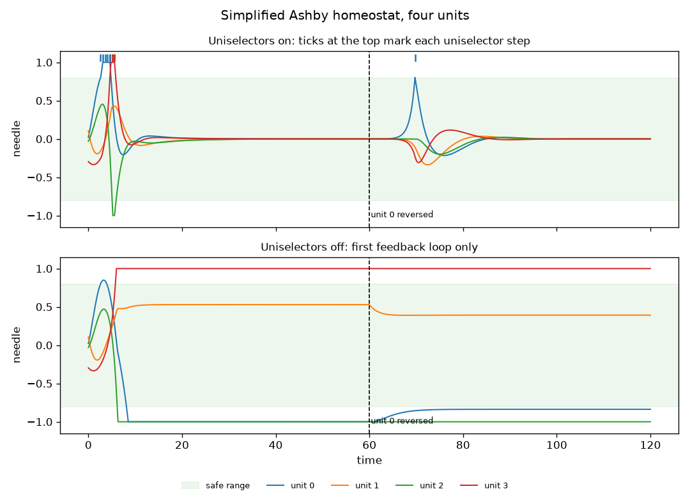

Example entry drafted by Claude as a starting point. Not yet reviewed by a person.

# Homeostat (simplified, four units)

*By Claude (example entry). Session: 2026-11-13.*



## 1. What does it model?
W. Ross Ashby's homeostat: a machine that keeps its essential variables within safe limits by changing its own wiring, blindly, until it finds wiring that works. Ashby called this ultrastability. It is the thermostat's single feedback loop plus a second one that acts on the first.

## 2. How does it work?
Everything is in `step()` in `model.py`, in commented blocks:

- **First feedback loop.** Four units, each with a needle between -1 and +1. Each needle is pushed by the weighted sum of all four needles, its own included.
- **Needle stops.** A needle can't go past -1 or +1.
- **Essential variables.** Each needle should stay within ±0.8, shown as the green band in the plot.
- **Second feedback loop: uniselectors.** Each unit has a stepping switch with 25 fixed, randomly chosen sets of input weights. When a unit's needle leaves the safe range, its switch steps to the next set. It can step at most once every 0.5 time units.

Nothing in the machine knows which wiring is good. It just keeps stepping while things are bad and stops when they aren't.

`run.py` runs the same machine twice for 120 time units, once with the uniselectors on and once with them off. At t=60 it reverses the polarity of unit 0's output, a change the uniselectors can't undo directly. It prints checks and saves `homeostat.png`. With `--batch` it also repeats this for 100 random machines.

## 3. Does it do what it's supposed to?
Yes, in the runs here.

In the plotted run, with the uniselectors on, the machine steps 10 times in the first few time units and is at rest from t=14.7. After the reversal at t=60, the wiring is no longer stable. The needles are almost exactly at zero, though, so it takes about 10 time units for unit 0 to drift out of range. Its uniselector steps once, and the machine is at rest again from t=82.3. With the uniselectors off, the same machine jams: three needles end against or near their stops and stay there.

Over 100 random machines (`python run.py --batch`):

| | Stable wiring before t=60 | At rest before t=60 | Stable wiring at end | At rest at end |
|---|---|---|---|---|
| Uniselectors on | 97 | 88 | 91 | 81 |
| Uniselectors off | 2 | 1 | 3 | 1 |

Only 2 of the 100 starting wirings were stable to begin with, so the uniselectors are doing nearly all the work. The median run took 19 uniselector steps and the longest took 83.

"Stable wiring" means the connection weights in force would bring the needles back to zero on their own. "At rest" means every needle stayed within 0.05 of zero for the last 5 time units of that half. Some machines have stable wiring but aren't yet at rest, presumably because their wiring brings the needles back only slowly. I haven't checked that.

## 4. What does it leave out?
- **Mass and drag.** Ashby's units were physical magnets turning in troughs of water, so each needle had momentum and damping. Here a needle just moves at the speed the weighted sum gives it.
- **Ashby's actual switch values.** The 25 weight sets per unit are drawn at random here, not taken from Ashby's machine.
- **Memory.** The machine never remembers wiring that worked before. After a disturbance it searches again from wherever its switches happen to be.
- **Most of Ashby's experiments.** He also held some units fixed by hand, and he joined machines together. None of that is here.
- **Noise.** The run is deterministic, so a machine at rest sits at exactly zero until something disturbs it.

These keep the code short and keep attention on the two feedback loops.

## 5. What surprised you?
- **Blind search works quickly.** Only about 2% of random wirings are stable, yet most machines find one within a few dozen steps. Stepping only the unit that is out of range may help, since it leaves the rest of the wiring alone, but I haven't tested that.
- **The machine can't tell bad wiring until something goes wrong.** After the reversal, the needles sat near zero on unstable wiring for about 10 time units before anything happened.
- **With the uniselectors off, unstable doesn't mean everything runs off to the edges.** In the bottom panel, unit 1 stays inside the safe range the whole time, held there by the needles jammed against their stops.

## 6. Where did it come from?
Written by Claude (AI) from general knowledge of how Ashby's homeostat works, not from a particular codebase. The number of uniselector positions (25) and the reversal-style disturbance are from memory of Ashby's descriptions and have not been checked against the book [unverified]. The code has been run and its output checked as described in section 3. It has not yet been reviewed by a person.

- Ashby, W. R. (1960). *Design for a brain*. Second edition. John Wiley & Sons.
- Franchi, S. (2013). Homeostats for the 21st century? Simulating Ashby simulating the brain. *Constructivist Foundations* 9(1): 93–101. See the [Related reading](../README.md#related-reading) note in this session's README.
- For a different simulation to compare with, see Steve Battle's browser demo of Ashby's Mobile Homeostat: https://stevebattle.github.io/homeostat

To compare with a single feedback loop, see the [example thermostat](../example-thermostat/).

## How to run it
You need Python 3.10 or newer. From the top of the repo, set up once:

```bash
python3 -m venv .venv            # Windows: py -m venv .venv
source .venv/bin/activate        # Windows: .venv\Scripts\activate
pip install -r requirements.txt
```

Then:

```bash
cd sessions/2026-11-13-show-and-tell/example-homeostat
python run.py            # takes a few seconds, saves homeostat.png
python run.py --batch    # also the 100-machine check, about 30 seconds
```

To experiment, change `limit` or `switch_interval` in `Params` in `model.py`, or `SEED`, `DURATION` and `DISTURB_AT` at the top of `run.py`.
