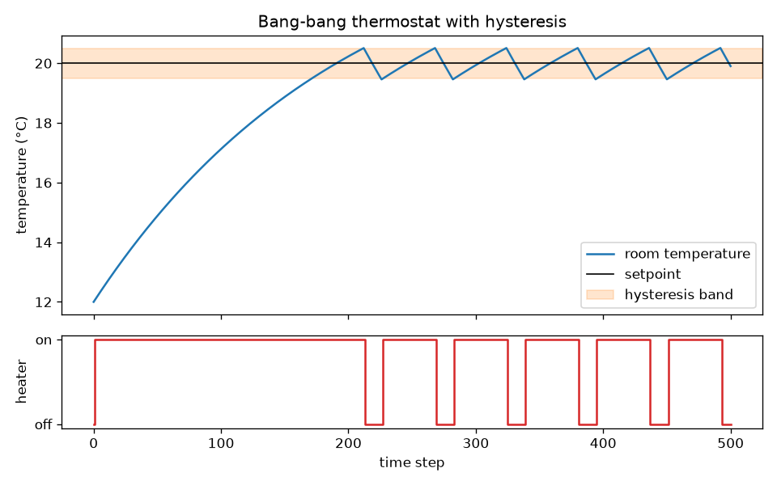

Example entry drafted by Claude as a starting point. Not yet reviewed by a person.

# Thermostat with hysteresis

*By Claude (example entry). Session: 2026-11-13.*



## 1. What does it model?
A heater controlled by a thermostat that keeps a room near a target temperature. It is about the simplest example of negative feedback: the system measures what it is controlling and acts to reduce the difference from a goal.

## 2. How does it work?
Everything is in `step()` in `model.py`, in four commented blocks:

- **Sensor:** reads the room temperature, with optional noise.
- **Comparator:** checks the reading against the setpoint. It turns the heater on below the bottom of a band (19.5 °C) and off above the top (20.5 °C). Inside the band it leaves the heater as it was. That memory is the hysteresis.
- **Effector:** the heater adds a fixed amount of heat each step while it is on.
- **Environment:** the room loses heat to the outside (5 °C) in proportion to the temperature difference.

`run.py` runs 500 steps from 12 °C with the heater off, prints a few checks, and saves `thermostat.png`.

## 3. Does it do what it's supposed to?
Mostly. Expected: the room warms to the band, then the heater cycles and the temperature saws back and forth inside it. That is what happens. The room reaches 19.5 °C at step 172, and after that the heater switches 11 times in the remaining steps.

One small departure: the temperature goes slightly past the band edges (19.46 to 20.51 °C, against a band of 19.5 to 20.5). This is because time moves in whole steps. The heater only reacts after the temperature has already crossed the line, so it overshoots by up to one step's worth of change. Smaller steps would shrink the overshoot but not remove it.

The cycle is lopsided: heating takes about 40 steps and cooling about 15. Near 20 °C the heater only just outpaces the heat loss, while cooling has the full loss working for it.

## 4. What does it leave out?
- **Real thermodynamics.** One number stands for the whole room. There is no air flow, no walls storing heat, and no difference between one corner and another.
- **Sensor lag.** The thermometer reads the current temperature instantly. Real sensors respond late, which makes overshoot larger and can make a controller unstable.
- **A learning or adapting controller.** The setpoint, band and heater power are fixed. The thermostat never changes how it responds, however badly things go.
- **Anything like Ashby's second feedback loop.** In Ashby's homeostat, when an essential variable goes out of bounds, the machine changes its own parameters at random until it finds a configuration that works. This thermostat has only the first loop. If you raised `loss_rate` so the heater could no longer keep up, it would run flat out forever and fail, never reorganizing. That makes it a useful contrast with a homeostat.

These were left out to keep the example short and to show what a single, fixed feedback loop can and can't do.

## 5. What surprised you?
How much of the behavior is set by the band rather than the setpoint. The band width decides how big the swings are and how often the heater switches. Sensor noise (`noise_sd` in `Params`) makes the heater chatter on and off near the edges. In a quick test, noise of 0.3 °C with the default band about doubled the number of switches, from 11 to 26. With a 0.2 °C band and the same noise there were 116. Worth trying.

## 6. Where did it come from?
Written from scratch by Claude (AI) as a standard textbook-style example, not from a particular paper or codebase. It has been run and the output checked against the expected behavior described in section 3. It has not yet been reviewed by a person.

For a homeostat to compare it with, see Steve Battle's browser demo of Ashby's Mobile Homeostat: https://stevebattle.github.io/homeostat

## How to run it
From this folder, with numpy and matplotlib installed (see the main README):

```bash
python run.py
```

This prints the checks from section 3 and saves `thermostat.png`. To experiment, change the values in `Params` in `model.py`.
